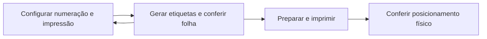

<div align="center">

# 🏷️ Sistema de Geração de Etiquetas para Triagem Neonatal

**Projeto acadêmico · Ciência da Computação · Projeto de Software**

*Numeração sequencial, códigos Code 128 e impressão em folhas Pimaco 6187, com foco no uso administrativo.*


</div>

---

## 🧭 Sobre o projeto

Este MVP apoia os profissionais que preparam etiquetas de identificação em um **Setor de Triagem Neonatal**, com foco em dificuldades de compatibilidade do software anterior e de alinhamento da impressão em equipamentos compartilhados.

A solução está sendo desenvolvida como **aplicação web Angular**. A geração ocorre no navegador, sem cadastro de pacientes, sem API e sem banco de dados remoto. O projeto tem contribuição **operacional e indireta** ao ODS 3 — Saúde e Bem-Estar; não realiza exames nem diagnósticos.

> **Estado:** versão inicial de desenvolvimento, destinada à evolução incremental e aos testes acadêmicos. A impressão real, a compatibilidade no setor e as metas de desempenho ainda precisam ser validadas. A publicação do código não significa autorização institucional nem homologação clínica.

## 🧩 Fluxo planejado



A estrutura em três etapas acompanha a especificação da Experiência Prática II. O layout visual e o comportamento final serão ajustados com base na validação com o público do setor.

## ✅ Funcionalidades contempladas no código inicial

- Configuração de identificador inicial, quantidade, dígitos e cópias (padrão demonstrativo: **7 dígitos e 2 cópias**).
- Geração numérica sequencial e códigos de barras **Code 128**.
- Layout **Pimaco 6187**: papel Carta, 4 colunas × 20 linhas, 80 etiquetas por folha.
- Posição inicial para aproveitamento de folhas parcialmente utilizadas.
- Ajustes horizontal e vertical em milímetros, número de folha e data.
- Pré-visualização de uma folha por vez, com navegação entre páginas.
- Preparação das páginas para impressão em lotes, sob demanda.
- Estrutura para persistência local opcional de perfis de calibração com **IndexedDB** (interface de gerenciamento de perfis ainda é desejável/futura).

A quantidade de 100 folhas é um **cenário de teste**, não um teto fixo: volumes maiores dependem dos recursos disponíveis no navegador e no equipamento.

## 🚀 Rodar no computador

**Pré-requisito:** Node.js compatível com Angular 21 (por exemplo, Node 22.12 ou superior na linha 22).

```bash
npm install
npm start
```

O Angular CLI abrirá o projeto no navegador, normalmente em `http://localhost:4200/`.

Para gerar a versão de produção:

```bash
npm run build
```

Para executar os testes das regras de negócio:

```bash
npm test
```

> **Atenção:** os pacotes do npm não estão incluídos no ZIP. Execute `npm install` conectado à internet na sua máquina. O arquivo `package-lock.json` gerado deve ser versionado para tornar a instalação reproduzível. O ambiente em que este repositório inicial foi preparado não pôde executar a instalação do npm; a compilação Angular e o funcionamento completo precisam ser confirmados localmente.

## 📂 Estrutura do repositório

```text
src/
  app/
    core/
      label-engine.ts          # Regras puras de numeração, cópias, páginas e posição
      label-engine.spec.ts     # Testes da lógica
      barcode.service.ts      # Geração de Code 128 via JsBarcode
    data/
      calibration-store.service.ts # Entidades locais em IndexedDB
    app.component.ts          # Fluxo de 3 etapas
    app.component.html        # Interface, pré-visualização e impressão
  styles.css                  # Estilos e dimensões físicas de impressão
  main.ts                     # Inicialização da aplicação
  index.html
public/
docs/
  ARQUITETURA.md
  TESTES_E_VALIDACAO.md
  imagens/                    # Capturas de referência do protótipo
.github/workflows/ci.yml     # Testes e build em pushes/PRs
```

## ☁️ Publicação e funcionamento offline

A aplicação Angular pode ser distribuída como arquivos estáticos, por exemplo, via **GitHub Pages**. A configuração de base URL precisa refletir o nome exato do repositório:

```bash
npm run build -- --base-href /Gerador_Etiquetas_Triagem_Neonatal/
```

Os arquivos para publicação ficarão em `dist/gerador-etiquetas/browser/`.

O Angular Service Worker está configurado para produção. Ele poderá disponibilizar os arquivos da aplicação offline **após o primeiro carregamento por HTTPS ou localhost**, mediante teste no ambiente escolhido. IndexedDB é local a cada navegador e não compartilha perfis entre computadores.

## 🖨️ Orientações de impressão

Selecione **papel Carta**, **escala de 100% / tamanho real**, sem margens extras e sem cabeçalhos/rodapés do navegador. Os ajustes X/Y são compensações; a posição final pode variar conforme driver e impressora. Use **dados fictícios** nos testes e confira a folha física antes da utilização no setor.

## 🔐 Privacidade e limites

- Não cadastrar nem armazenar nomes de recém-nascidos, dados clínicos ou identificadores reais de amostras neste projeto público.
- Não incluir senhas, tokens, documentos institucionais ou fotografias com dados restritos.
- A publicação no GitHub permite acesso público ao **código-fonte**, não constitui autorização para processamento de dados sensíveis.
- A versão acadêmica não implementa contas de usuário nem servidor de autenticação. O acesso ao equipamento obedece às normas do setor.

## 🧪 Próximas validações

As tarefas presenciais planejadas são: localizar o gerador, preparar uma folha com identificadores fictícios e compreender o resultado e as instruções de impressão. Serão registrados sucesso, tempo, erros e satisfação, com concordância do participante.

Mais detalhes: [Arquitetura](docs/ARQUITETURA.md) · [Plano de testes](docs/TESTES_E_VALIDACAO.md).
